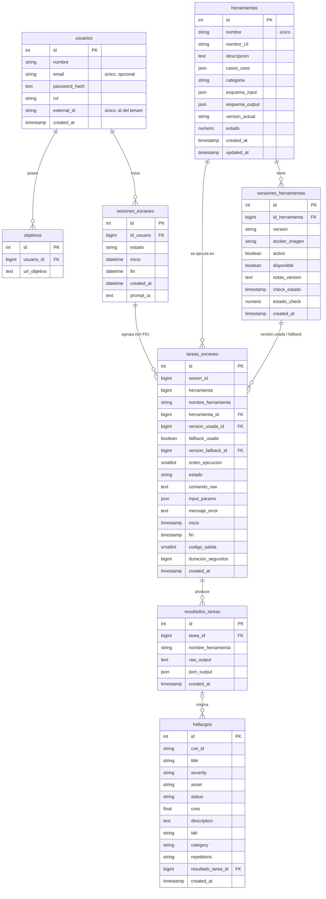

# Modelo de datos — eth-runner

Motor: **SQLite** (`./data/runner.db`), accedido con SQLAlchemy asíncrono (AioSQLite).
Cada runner tiene su propia base: los datos de un cliente nunca salen de su runner.
Las tablas se crean al iniciar el API Gateway y el Tool Registry (`Base.metadata.create_all`).
Fuente: `shared/database/models/`.

## Diagrama entidad-relación

## Diccionario de tablas

| Tabla | Propósito | Claves y relaciones |
| --- | --- | --- |
| `usuarios` | Cliente (tenant) del Orquestador representado en el runner. | `external_id` único: alta idempotente desde el Orquestador. |
| `objetivos` | URL o host autorizado para escanear de un usuario. | `usuario_id` → `usuarios.id`. |
| `sesiones_escaneo` | Campaña de escaneo de un usuario; agrupa tareas. | `id_usuario` → `usuarios.id`. No guarda `objetivo_id` (se usa solo para resolver el usuario). |
| `herramientas` | Catálogo de herramientas con sus esquemas de entrada y salida. | `nombre` único. |
| `versiones_herramientas` | Versiones de cada herramienta y la imagen Docker que las ejecuta. | `id_herramienta` → `herramientas.id`. Una versión activa; las fallidas quedan `disponible = false`. |
| `tareas_escaneo` | Cada ejecución de una herramienta: estado, parámetros, tiempos y código de salida. | `herramienta_id`, `version_usada_id`, `version_fallback_id` → tablas de herramientas. `sesion_id` es relación lógica, sin FK. |
| `resultados_tareas` | Salida de la herramienta: texto crudo y JSON estructurado. | `tarea_id` → `tareas_escaneo.id`. |
| `hallazgos` | Vulnerabilidades para el dashboard (CVE, severidad, CVSS, activo, estado). | `resultado_tarea_id` → `resultados_tareas.id` (opcional). |

## Ciclo de vida de una tarea

`pendiente` → `corriendo` → `completado` o `fallido`. Al pasar a `corriendo` se registra `inicio`; al terminar se guardan `fin`, `codigo_salida`, `duracion_segundos` y el resultado en `resultados_tareas`.

## Observaciones

- `tareas_escaneo.sesion_id` no tiene clave foránea declarada; la integridad depende de la aplicación.
- La tabla `hallazgos` existe y la leen `/findings` y `/metrics/*`, pero todavía no se llena automáticamente desde los resultados (historia HU-16 del backlog).
- No hay migraciones: un cambio en un modelo existente requiere regenerar `data/runner.db` en desarrollo.
