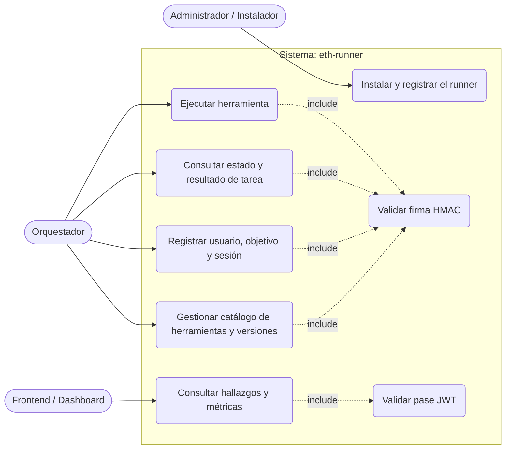
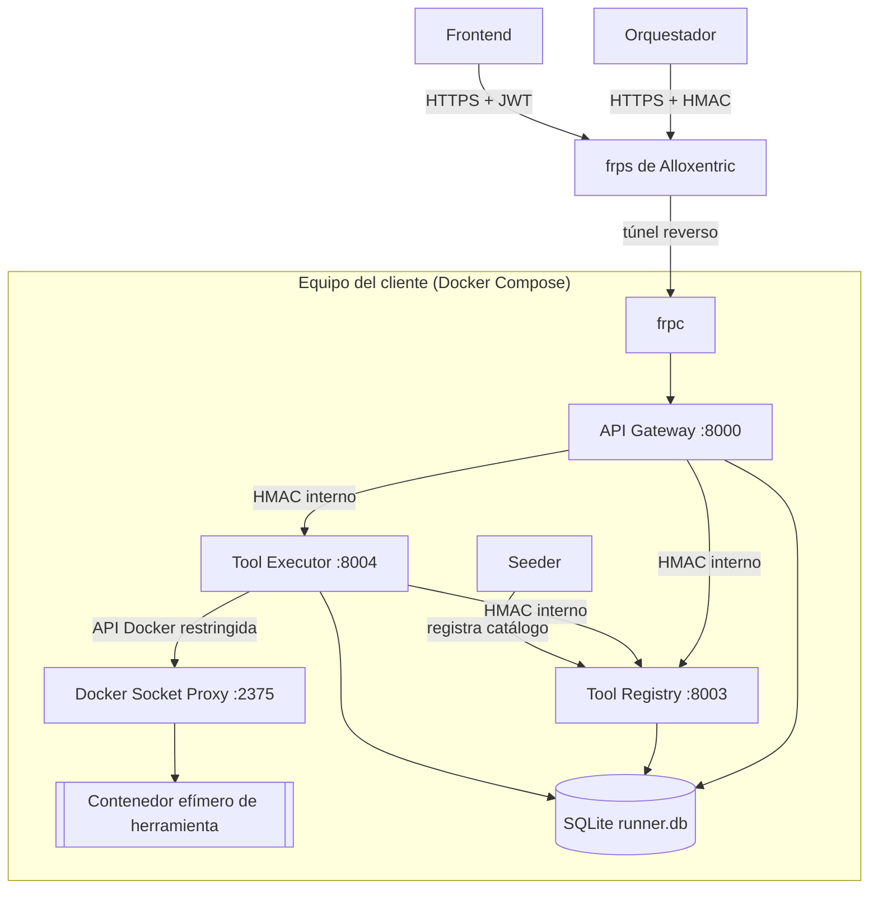
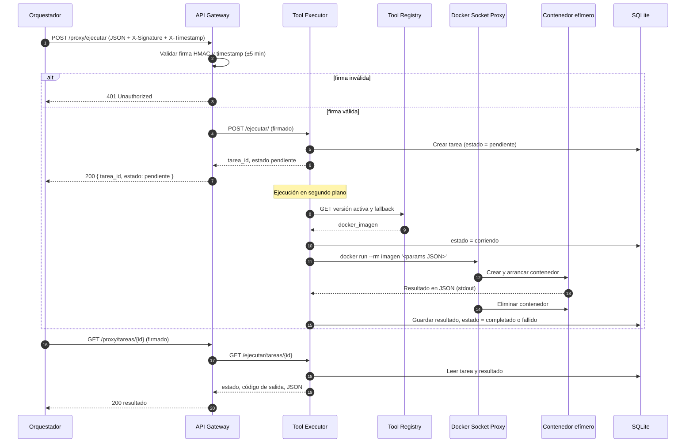
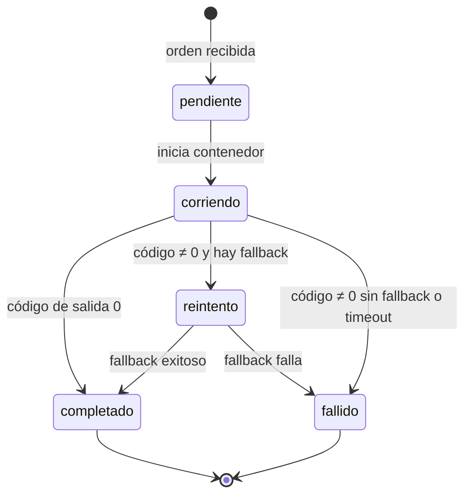
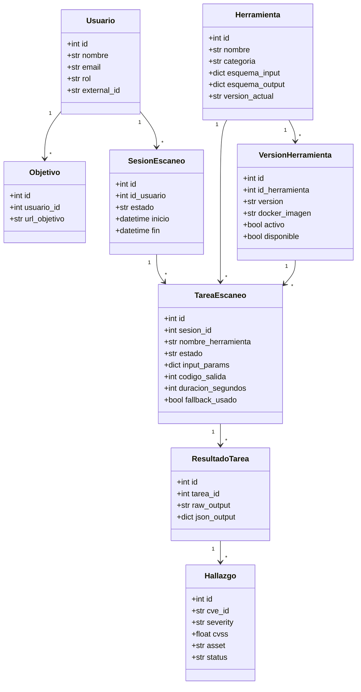

# Diagramas UML — eth-runner

Los diagramas están escritos en Mermaid y GitHub los muestra como imagen al abrir este archivo.

## 1. Casos de uso

## 2. Diagrama de componentes

## 3. Diagrama de secuencia: ejecutar una herramienta

## 4. Diagrama de estados de una tarea

Los estados que se guardan en `tareas_escaneo.estado` son `pendiente`, `corriendo`, `completado` y `fallido`. El `reintento` con la versión de fallback ocurre dentro del Executor y no se guarda como estado propio; queda registrado en `fallback_usado` y `version_fallback_id`.

## 5. Diagrama de clases (modelo de dominio)

